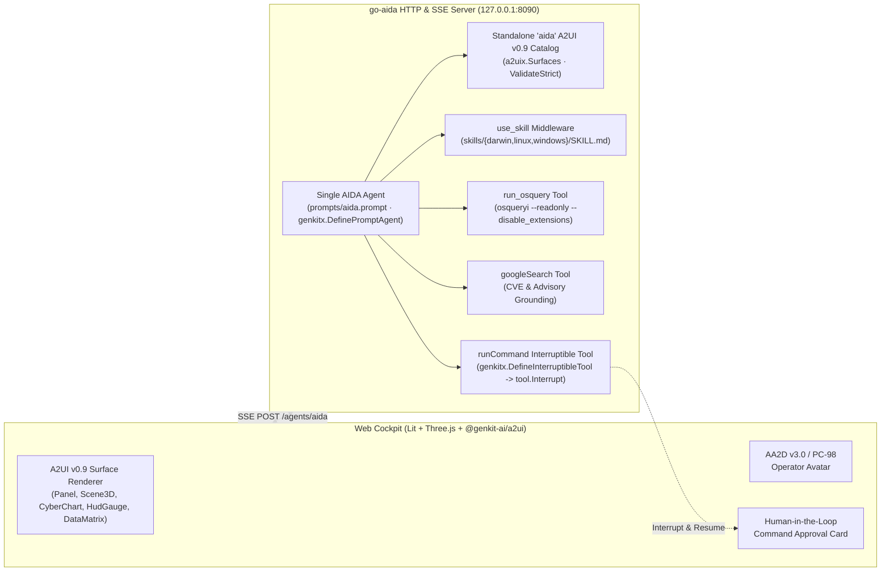

# AIDA (`go-aida`) — AI Diagnostic Agent with Genkit Go, A2UI v0.9 & Human-in-the-Loop

**AIDA** (`go-aida`) is an AI-powered host diagnostic and remediation agent built in Go with **[Genkit Go](https://genkit.dev)**. It serves as a reference implementation showcasing two core Genkit Go capabilities:

1. **Generative UI with [A2UI v0.9](https://github.com/google/A2UI)** (`github.com/firebase/genkit/go/plugins/a2ui/exp` on the backend and `@genkit-ai/a2ui` + `@a2ui/lit` on the frontend), using a standalone 8-component `"aida"` catalog with strict server-side schema validation (`a2uix.ValidateStrict`).
2. **Human-in-the-Loop (HITL) Interruptible Tools** (`genkitx.DefineInterruptibleTool` and `tool.Interrupt`), allowing the agent to propose host remediation commands (`runCommand`), pause the turn until the human operator approves or denies the command in the Web Cockpit, and resume the session seamlessly.

AIDA runs as a **single agent** (`prompts/aida.prompt`) with all tools exposed directly on the agent: `use_skill` (OS-specific `osquery` schemas for `darwin`, `linux`, and `windows`), `run_osquery` (read-only live SQL telemetry), `googleSearch` (external CVE & advisory lookup), and `runCommand` (HITL shell execution).

---

## Architecture



### Core Components

1. **Single AIDA Agent ([`prompts/aida.prompt`](prompts/aida.prompt), [`internal/agent/agent.go`](internal/agent/agent.go))**:
   - Defined via `genkitx.DefinePromptAgent` and exposed over HTTP/SSE via `genkitx.AllAgentRoutes` (`POST /agents/aida`).
   - Powered by **`gemini-3.8-flash`** (`ThinkingLevel: LOW`) via either **Vertex AI** (`vertexai/gemini-3.8-flash`) or **Google AI** (`googleai/gemini-3.8-flash`).
   - All tools and middleware are attached directly to the single `aida` agent—no sub-agent routing or delegation overhead.

2. **A2UI v0.9 Custom Catalog & Strict Validation ([`internal/agent/catalog.go`](internal/agent/catalog.go), [`web/src/aida-catalog/`](web/src/aida-catalog/))**:
   - Registers a standalone 8-component `"aida"` catalog (`a2uix.LoadCatalog`) and validates every generated surface with `&a2uix.Surfaces{CatalogID: "aida", Instructions: a2uix.InstructionsNone, Validate: a2uix.ValidateStrict}` wrapped in `&middleware.Retry{MaxRetries: 3}`:
     - `Panel`: Layout container card with title, subtitle, status LED (`nominal`, `warning`, `critical`), and flat child ID references.
     - `Scene3D`: Interactive Three.js 3D WebGL graph (`topology`, `cores`, `storage`, `threat_radar`) with clickable nodes.
     - `CyberChart`: Multi-mode SVG telemetry chart (`radar`, `radial`, `area`, `bar`, `donut`).
     - `HudGauge`: Arc, 20-segment plasma, and compact digital metric readouts.
     - `DataMatrix`: Sortable, filterable table for `osquery` rows with inline percentage bars and row drill-down actions.
     - `TextBlock`: Code, SQL, command output, or log viewer.
     - `ActionButton`: Dispatches follow-up diagnostic prompts or zero-round-trip client self-actions (`aida:*`).
     - `CockpitControl`: Client-side control deck that mutates theme presets, font scale, scanlines, tab navigation, or avatar mode directly in the browser without calling the model.

3. **Human-in-the-Loop (HITL) Remediation ([`internal/agent/remediate.go`](internal/agent/remediate.go), [`web/src/aida-cockpit.ts`](web/src/aida-cockpit.ts))**:
   - Registers `runCommand` using `genkitx.DefineInterruptibleTool[CommandInput, CommandOutput, CommandConfirmation]`.
   - On initial invocation (`res == nil`), `runCommand` halts execution with `tool.Interrupt(CommandInterrupt{Command, Reason, Risk})`.
   - The Web Cockpit renders an interactive approval card (`[✓ APPROVE]` / `[✗ DENY]`) and resumes the stream via `chat.resumeStream({ restart: [restartPart] })`.

4. **Read-Only `osquery` & Per-OS Skills ([`internal/osquery/osquery.go`](internal/osquery/osquery.go), [`skills/`](skills/))**:
   - `use_skill`: Injects platform-specific `osquery` table schemas and `WHERE` clause constraints from [`skills/darwin/SKILL.md`](skills/darwin/SKILL.md), [`skills/linux/SKILL.md`](skills/linux/SKILL.md), or [`skills/windows/SKILL.md`](skills/windows/SKILL.md).
   - `run_osquery`: Executes read-only `osqueryi --readonly=true --disable_extensions=true --disable_carver=true --ephemeral=true --json` queries with strict read-only SQL validation.

---

## Prerequisites

- **Go**: `1.27+`
- **Node.js & npm**: Node.js `20+` and `npm` (for building the Vite + TypeScript Web Cockpit in `web/`)
- **`osqueryi`**: Installed and available on your system `PATH`
  - **macOS**: `brew install --cask osquery` (or `brew install osquery`)
  - **Ubuntu / Debian**: Follow [osquery Linux installation instructions](https://osquery.io/downloads/official)
- **Model Credentials** (choose one):
  - **Google AI (Gemini Developer API)**: Set `GEMINI_API_KEY` (or `GOOGLE_API_KEY`) in your environment.
  - **Google Cloud Vertex AI**: Set `GOOGLE_CLOUD_PROJECT` (or pass `-project`) and authenticate with Application Default Credentials:
    ```bash
    gcloud auth application-default login
    ```

---

## Quick Start

### 1. Install Frontend Dependencies & Build Web Cockpit

```bash
make setup
make build-web
```

### 2. Launch the Interactive Web Cockpit

```bash
# Using Google AI (Gemini API Key)
export GEMINI_API_KEY="your-api-key"
make run

# Or using Google Cloud Vertex AI
export GOOGLE_CLOUD_PROJECT="your-gcp-project-id"
go run . -model vertexai/gemini-3.8-flash
```

Open **`http://127.0.0.1:8090`** in your browser to launch the AIDA Web Cockpit.

### 3. Headless CLI One-Shot Mode

Run a single diagnostic prompt directly in your terminal without starting the web server:

```bash
go run . -prompt "Inspect top 5 CPU processes and memory usage"
```

---

## CLI Flags Reference

| Flag | Default | Description |
| :--- | :--- | :--- |
| `-addr` | `127.0.0.1:8090` | HTTP listen address for the Web Cockpit server. |
| `-allow-remote` | `false` | Allow binding `-addr` to non-loopback interfaces (e.g. `0.0.0.0:8090`). Use with caution. |
| `-prompt` | `""` | Run a one-shot diagnostic prompt in headless CLI mode and exit. |
| `-model` | `""` (auto-selected) | Genkit model identifier (`googleai/gemini-3.8-flash` or `vertexai/gemini-3.8-flash`). Defaults to `vertexai/gemini-3.8-flash` when a GCP project is configured, otherwise `googleai/gemini-3.8-flash`. |
| `-project` | `$GOOGLE_CLOUD_PROJECT` | Google Cloud project ID for Vertex AI. |
| `-location` | `global` (or `$GOOGLE_CLOUD_LOCATION`) | Google Cloud region for Vertex AI. |
| `-assets` | `assets` | Directory containing avatar sprite and rig assets. |
| `-web-dir` | `web/dist` | Directory containing compiled frontend static bundle. |
| `-prompts` | `prompts` | Directory containing Dotprompt (`.prompt`) definitions. |
| `-skills` | `skills` | Directory containing OS-specific agent skills. |

---

## Development & Verification

Use the root [`Makefile`](Makefile) to build, lint, and test both the Go backend and TypeScript Web Cockpit:

```bash
# Install frontend packages
make setup

# Build web/dist and compile bin/go-aida
make build

# Run go vet and TypeScript typechecking
make lint

# Run Go race-detector tests and TypeScript check
make test

# Remove build artifacts
make clean
```

---

## Third-Party Attributions

- **[osquery](https://osquery.io/)**: Executed as an external binary (`osqueryi`) for read-only operating system instrumentation. Licensed under the [Apache License 2.0](https://github.com/osquery/osquery/blob/master/LICENSE).
- **Google Fonts**: The Web Cockpit loads [`Orbitron`](https://fonts.google.com/specimen/Orbitron), [`Share Tech Mono`](https://fonts.google.com/specimen/Share+Tech+Mono), and [`VT323`](https://fonts.google.com/specimen/VT323), licensed under the [SIL Open Font License 1.1 (OFL-1.1)](https://scripts.sil.org/OFL).

---

## License

Apache 2.0 - See [LICENSE](LICENSE) for more information.

## Disclaimer

This is not an officially supported Google product. This project is not eligible for the [Google Open Source Software Vulnerability Rewards Program](https://bughunter.withgoogle.com/open-source-security).
